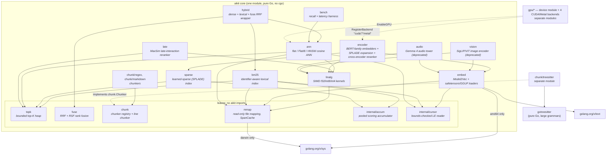
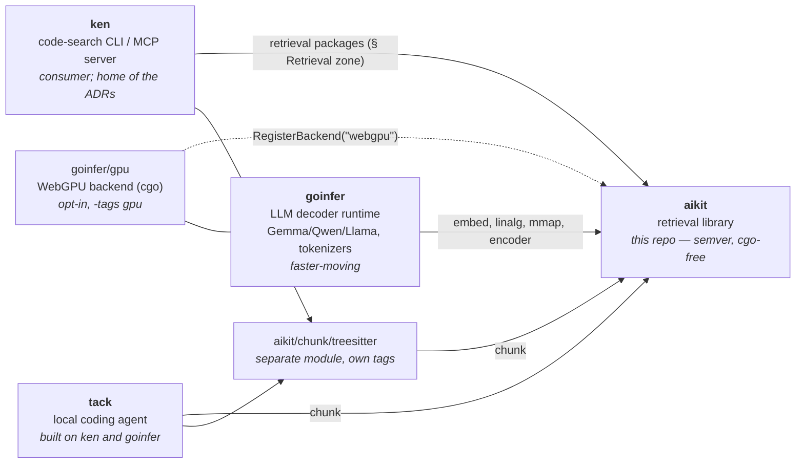
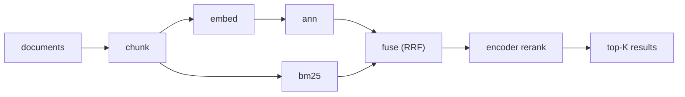

# aikit architecture

How the pieces fit together: the package DAG, the surrounding repo ecosystem,
the two dependency quarantines, and where the load-bearing invariants live.
For what each package *does*, see the [README package table](../README.md#packages);
for API stability, the [stability tiers](../README.md#stability-tiers). This
doc is about structure and the decisions behind it.

## Design rules

Four rules generate most of the structure:

1. **The core stays pure Go (no cgo).** Enforced in CI (`CGO_ENABLED=0` build
   + a dependency-graph grep). Anything that would break this is pushed
   behind a seam (§ Backend) or into a separate module (§ Quarantines).
2. **Packages are small leaves; the DAG stays shallow.** Enforced by a test:
   [`internal/importrules`](../internal/importrules/importrules_test.go) holds
   the exact list of aikit and external packages each core package imports,
   and fails, naming the edge, when the tree and the list disagree
   (§ Package DAG). Six packages import nothing but the stdlib and
   `golang.org/x`; the longest chain in the library is three imports
   (`hybrid` → `ann` → `linalg` → `mmap`). Two Go-internal packages
   (invisible to importers) cut duplication between otherwise-independent
   packages that had drifted apart: `bm25` and `sparse` share
   `internal/accum` (a pooled scoring accumulator), and `ann`, `bm25` and
   `embed` share `internal/cursor` (the bounds-checked little-endian reader
   behind the HNSW/FlatI8 and BM25 blob formats and GGUF's container format).
3. **Numerics are parity-pinned.** Every model-touching path (`embed`,
   `encoder`, the `linalg` quant kernels) is tested against golden fixtures
   produced by Python references in [`scripts/`](../scripts/) — see
   [`testdata/README.md`](../testdata/README.md).
4. **Indexes are immutable after build.** Every retrieval index — `ann.Flat`,
   `ann.HNSW`, `ann.FlatI8`, `bm25.Index`, `sparse.Index` — is read-only once
   built. This is a cornerstone, not an accident: it buys two things the rest of
   the design leans on, and gives them up the moment in-place mutation is allowed.

   - **Lock-free concurrent reads.** A built index takes no locks in `Query`, so
     it scales across goroutines for free. Mutation would force an `RWMutex` (or
     hand-rolled lock-free structures) onto the query hot path — slower, and a
     whole class of concurrency bugs that immutability simply does not have.
   - **Snapshot consistency without coordination.** A "the corpus changed" update
     builds a *new* index and swaps a pointer atomically (ken's ADR-012 pattern);
     a reader holds one consistent snapshot for the life of a query — no torn
     reads, no mid-query mutation.

   Changing corpora are served *without* breaking this, in increasing order of
   freshness: **rebuild-and-swap** (the default — re-index, publish the new
   pointer); a **base + delta + fuse** split (a small, frequently-rebuilt delta
   index fused with the big base via `fuse.RRF`/`RSF`, periodically folded in);
   and **logical delete** via a caller-supplied tombstone predicate
   (`Flat`/`HNSW`/`FlatI8` `QueryFilter`) consulted at query time — the index
   itself is never mutated. True in-place mutation (HNSW tombstone graph-repair,
   concurrent `Add`-during-`Query`, incremental BM25 segments) is deliberately out
   of scope: it's a mutable-database concern that would trade away both properties
   above, for a use case outside aikit's embedded, read-heavy niche.

## Package DAG

Drawn from the table in
[`internal/importrules`](../internal/importrules/importrules_test.go), which
`go test ./...` checks against `go list` on linux, windows and darwin, amd64 and
arm64. A solid arrow is an import. If you change an import, the test fails
until the table changes, and this diagram changes with the table.

Not drawn, but in the table: the four `examples/*` programs and
`bench/cmd/benchreport`, which sit on top and which nothing imports, and
`internal/importrules` itself. Test-only imports are not in the table either
(`ann`'s tests import `embed` and `fuse`, for one); the rule is about what an
importer's build pulls in.

**Leaves.** `topk`, `fuse`, `chunk`, `mmap`, `internal/accum` and
`internal/cursor` import no aikit package. `mmap` is the newest of them and
the one most of the tree now rests on: it is the read-only file mapping under
every loader that maps a blob from disk instead of copying it.

**One step up.** `linalg` imports `mmap` and nothing else, so it is no longer
a leaf. `embed` imports `mmap` and `internal/cursor`. `sparse` imports `topk`
and `internal/accum`. `bm25` imports `topk`, `internal/accum`,
`internal/cursor` and `mmap`: its postings arena maps from disk and its blob
format is read through the shared cursor. `chunk/regex` and `chunk/markdown`
import `chunk`; the line chunker is a file in `chunk`, not a package.

**Two steps up.** `ann` selects through `topk`, scores through `linalg`'s SIMD
dot kernels, reads its blobs through `internal/cursor` and maps them through
`mmap`. `late` (ColBERT-style MaxSim reranking) imports `linalg` and `topk`.
`encoder`, `vision` and `audio` are the model towers, each on `embed` +
`linalg`. `encoder` also imports `sparse`: `encoder.SPLADE.Expand` produces
the `sparse.SparseVec` values the `sparse` package indexes, so the SPLADE loop
(BERT + masked-LM head → sparse vector → inverted index) runs end-to-end
in-process. `vision` and `audio` are deprecated and frozen at v1.75.0; they
moved to goinfer (see the README).

**Three steps up.** `hybrid` composes `ann`, `bm25` and `fuse`; `bench`
imports `ann`. Nothing in the library is deeper.

**External dependencies.** Two modules, three imports, all in the table:
`embed` imports `golang.org/x/text/unicode/norm` (tokenizer normalization) on
every platform and `golang.org/x/sys/cpu` on amd64 (feature detection for the
Q4_K dequant kernel); `mmap` imports `golang.org/x/sys/unix` on darwin only
(`madvise`). No other package imports anything outside the stdlib and aikit.
`vision` adds none: its image decode uses only stdlib codecs (`image/jpeg`,
`image/png`).

**The dotted edges are registry-based, not imports**, and the same test
asserts that no core package reaches `gpu/` or `chunk/treesitter`, directly or
through a dependency. `chunk/treesitter` registers itself via `chunk.Register`
on import, and each `gpu/*` backend registers itself via the matching seam
(`FlatI8.EnableGPU`, `encoder.RegisterBackend`) on import. Like `encoder`, `vision` exposes an import-free GPU-export seam
(`GPUWeights`) plus the `RegisterResident` inversion, so a WebGPU backend
(e.g. goinfer's) plugs in without the core importing it. See § Quarantines and
[`docs/task-native-gpu.md`](task-native-gpu.md) for the backend-by-backend
detail (device substrate, per-seam kernels, parity gates).

## Retrieval zone

aikit serves two consumers on one version line. **ken** uses the retrieval
packages. **goinfer** uses `linalg` and `embed`'s model-file readers, and
drives most releases. ken re-runs its parity and recall checks on every aikit
bump, so each release says whether it could reach ken at all: its CHANGELOG
section carries a line `RETRIEVAL: yes` or `RETRIEVAL: no`, computed by
`go run -C tools ./retrievalmark` from the files changed since the previous
tag, and the release gate refuses a release without it. On a `no` release a
retrieval-only consumer can skip those checks.

The zone is the part of the module a retrieval result or the retrieval API
depends on.

**In the zone whole.** A change to any non-test file in these packages is a
retrieval change:

| Package | ken imports it |
|---|---|
| `topk`, `fuse` | yes |
| `chunk`, `chunk/regex`, `chunk/markdown` | yes |
| `bm25`, `ann` | yes |
| `encoder` | yes |
| `sparse` | no; it is in ken's build through `encoder` |
| `hybrid`, `late` | no; retrieval API that ken does not use today |

**In the zone in part.** ken imports `embed` and `linalg` directly, for a few
entry points, and the zone packages reach into both. A file in these packages
(and in `mmap`, `internal/accum` and `internal/cursor`, which only the
packages above reach) is in the zone if the zone reaches a declaration in it:

| Package | ken's entry points |
|---|---|
| `embed` | `embed.StaticModel`, `embed.Load`, `embed.LoadFromFS`, `embed.LoadMmap` (Model2Vec and its tokenizer) |
| `linalg` | `linalg.Workspace`, `linalg.QuantizeRowInt8`, `linalg.PackSignBitsRow` |

On 2026-11-10 that put 8 of `embed`'s 24 files in the zone (the GGUF readers
and dequant kernels are out) and 158 of `linalg`'s 185 (fused attention, the
`Acc64` attention kernels and the FMA peak probes are out). `encoder` is why
so much of `linalg` is in: it uses the quantized matmuls, not only the dot
kernels. `go run -C tools ./retrievalmark --files` prints the current split
with the reason for each file.

**Outside the zone.** `vision`, `audio`, `bench`, the examples, every test
file and fixture, the docs, and every nested module. `chunk/treesitter` is on
ken's search path, but it is a separate module with its own tags, so a root
release cannot change it.

**How a file is classified.** `tools/retrievalzone` parses every non-test Go
file in the module, whatever its build constraints, and walks names outward
from the zone packages and the entry points above. The walk over-approximates
on purpose: a reached file brings everything it declares, a reached type
brings all its methods, every `init` function and every package-level variable
initialized by a call is reached in each package the zone links, and a reached
assembly stub brings the `.s` file that implements it. A test deletes every
file the walk left out and type-checks the zone on each platform and build tag
the core is built for, so a name the walk missed fails to compile.

**How it fails safe.** There is no list of files, so a new file needs no
entry. A path no rule recognizes is in the zone, and so is every changed path
when a tree does not parse. A file is judged in the tree before the change and
the tree after, and either saying "zone" is enough. In `go.mod`, only a
change confined to the `toolchain` line (which a consumer's build does not
read) is outside. The gate accepts a recorded `yes` over a computed `no`, and
never the reverse.

**What keeps the lists honest.** The two tables above are checked against
`tools/retrievalzone` by its tests. Whether they still match ken is checked by
`go run -C tools ./retrievalmark --ken <ken checkout>`, which fails if ken
imports an aikit package, or uses an `embed` or `linalg` name, that the zone
does not list. Run it when ken's use of aikit changes; nothing runs it
automatically, because aikit's CI has no ken checkout.

## Repo ecosystem

aikit is the stable middle of a four-repo system:

aikit was extracted so the retrieval core could make a semver promise while
the LLM runtime keeps moving (the split is recorded in goinfer's
[`migration-plan.md`](https://github.com/townsendmerino/goinfer/blob/main/docs/migration-plan.md);
the motivating critique in
[`internal/archive/road-to-1.0-critique.md`](./internal/archive/road-to-1.0-critique.md)).
Dependencies point inward only: goinfer, ken and tack import aikit; aikit imports
none of them. What each one imports was read from its tree on 2026-11-10
(goinfer also imports `bench` in a release-gate tool).

## The Backend seam

The most consequential decision in the repo
([`encoder/backend.go`](../encoder/backend.go)): the encoder's forward pass
abstracts exactly one primitive — `MatmulBT` (`dst[M,N] = a[M,K]·b[N,K]ᵀ`,
the safetensors `[out,in]` weight layout, so no transpose copy). Norms,
RoPE, softmax, and elementwise ops always run on CPU; only the big weight
matmuls route through the `Backend` interface.

The default `"cpu"` backend (pure-Go SIMD) is compiled in. GPU is an
*inversion*: an external package calls `encoder.RegisterBackend(name, …)`
from its `init()`, and aikit gains GPU acceleration without the cgo
dependency ever entering its module graph. Two implementations exist: an
external one (`goinfer/gpu`, registers `"webgpu"`) and aikit's own native
ones (`gpu/enccuda`/`gpu/encmetal`, in this repo, register `"cuda"`/`"metal"`
— see § Quarantines). `NewBackend(name)` on a build that never imported a
registering package degrades to CPU with an explanatory error rather than
failing. `ann` and `vision` have analogous inversions of their own
(`FlatI8.EnableGPU`, `vision.RegisterResident`) that aikit's `gpu/anncuda`
family also plugs into — same pattern, different interface, because `ann`'s
and `vision`'s hot paths aren't a single matmul the way `encoder`'s is.

Why only matmul for `encoder`: it's the hot path by a wide margin, and
keeping everything else on CPU avoids a host↔device round-trip per layer.

## Quarantines

Three kinds of dependency are deliberately kept out of the core module graph,
each by a different mechanism (CI enforces all three):

| Dependency | Why quarantined | Mechanism |
|---|---|---|
| `cogentcore/webgpu` (cgo) | would break the no-cgo promise | inverted behind `encoder.Backend`; lives in `goinfer/gpu`, not this repo |
| `gotreesitter` (pure Go, ~large embedded grammars; pre-1.0 upstream) | payload size + upstream churn risk | separate module `chunk/treesitter`, registers via `chunk.Register`; its own tag series (§ Nested modules) |
| CUDA/Metal bindings — aikit's own native GPU backends | their dependencies (`purego`, `gocudrv`) and device code stay out of the core graph | `gpu/*`: a shared device-substrate module (`gpu`) plus 4 one-backend-per-module leaves (`anncuda`/`annmetal` → `FlatI8.EnableGPU`; `enccuda`/`encmetal` → `encoder.RegisterBackend("cuda"/"metal", …)`, the same seam `goinfer/gpu` uses). The four tower backends (`qwencuda`/`qwenmetal`, `visioncuda`/`visionmetal` → `vision.RegisterResident`) moved to goinfer and were deleted from this tree on 2026-11-10; their tags still resolve; each on its own tag series, pinned to the frozen `gpu/v0.35.x` device module by `tools/gpupins` (§ Nested modules); full detail in [`docs/task-native-gpu.md`](task-native-gpu.md) |

## Nested modules and their versions

The repo holds one core module and a set of nested ones. **They are not
versioned in lockstep.** Each published nested module has its own tag series
(`<dir>/vX.Y.Z`) and gets a tag when its own code changes, not when the root
does. What its `go.mod` says about the root is a requirement, and it means
different things per module:

| Module | Published | What its `go.mod` requires of this repo | `replace` into the tree |
|---|---|---|---|
| `chunk/treesitter` | yes | `aikit v1.0.0`, a **minimum**: it needs only the `chunk.Chunker` contract, which is Hard tier | no |
| `gpu` (device module) | yes, frozen on `gpu/v0.35.x`, fixes only | nothing | no |
| `gpu/anncuda`, `gpu/annmetal`, `gpu/enccuda`, `gpu/encmetal` | yes | `aikit v1.75.0` and `aikit/gpu v0.35.x`, a **freeze pin** held by `tools/gpupins` | yes |
| `benchmarks`, `examples/embedded-corpus`, `examples/gpu-ann`, `tools`, `tools/canary/vulnfixture` | **no: tree-only**, never tagged | a placeholder | yes, where it requires the root |

Deleted from the tree, tags still resolving: the four tower backends
(`gpu/qwencuda` and `gpu/qwenmetal`, last tags `v0.1.1`; `gpu/visioncuda` and
`gpu/visionmetal`, `v0.1.0`), removed 2026-11-10 after confirming no `go.mod` in
goinfer, ken or tack required them. `gpu/webgpu` was removed with them; it never
had a tag.

Three things follow, and each has a check.

**A consumer gets the newest of the versions in play, not the one the nested
module names.** ken requires `chunk/treesitter v1.2.0` and `aikit v1.76.0`, so
it builds the chunker against v1.76.0 even though the chunker's `go.mod` says
v1.0.0. Both ends therefore matter: the required version (the oldest a consumer
could get) and the tree (the newest).

**A `replace` hides the required version from every in-tree build.** With the
replace in place, the gpu backends build, lint and test against the tree's
aikit; a consumer's build ignores a dependency's replaces and gets v1.75.0. So
CI has one job that takes the replaces away: `nested modules at their required
versions` runs `go run -C tools ./consumergate --head`, which copies each
published nested module out of the checkout, drops its replace directives, and
vets it with `GOWORK=off` against the proxy (and runs its tests, outside
`gpu/`, whose tests need a device and are hand-run). `chunk/treesitter`, which
has no replace and so is otherwise built only at its minimum, gets a second leg
there against the tree. The other legs already existed: `gpu mechanical gate`
builds the gpu modules against the tree, and `consumer-resolution` resolves and
builds each published *tag* from a scratch module, on every tag push and weekly.

**A tree-only module's require line is not a claim.** `benchmarks` names
`aikit v1.2.1` and `examples/embedded-corpus` names `v1.3.0`; neither compiles
against that version without its replace (measured 2026-11-10:
`encoder.LoadBERT` and `StaticModel.EncodeBatch` are newer), and
`examples/gpu-ann` requires backend versions `v0.0.0` that do not exist. They
are programs that live in the tree and are built there. They are listed as
`internal` in `tools/consumergate/classify.go`, which fails on any `go.mod` it
does not know, so a new module cannot be added without choosing a side. If one
of them is ever tagged, move it to `published` there and `--head` will hold it
to its require.

## Retrieval pipeline (how a consumer composes it)

The packages are independent; the canonical composition
([`examples/rag/`](../examples/rag)) is:

Nothing in aikit requires this shape — each stage is independently usable,
and `fuse` works on any rankings with comparable keys.

The `ann2 --> fuse2 <-- bm252` piece — retrieve both signals, fuse.RRF them —
is the same four lines in every hybrid-search example (`examples/rag`,
`examples/colbert`). [`hybrid.Retriever`](../hybrid) is a thin, opt-in wrapper
around exactly that piece, for callers who'd rather not repeat it; it composes
already-built indices (doesn't build them, embed, tokenize, chunk, or rerank)
and stays out of the way of anyone who prefers to hand-wire `fuse.RRF`
directly, which every example here still does.

## Where the invariants live

The correctness-critical contracts are documented at the point of use; this
is the index:

| Invariant | Lives at |
|---|---|
| `ann` requires L2-normalized inputs; normalization happens at the `embed` boundary | [README carry-over invariants](../README.md#carry-over-invariants-read-these-once), `ann/flat.go` doc |
| `embed` accumulates in float64 (f32 silently breaks golden parity on longer inputs) | `embed/model.go` precision contract, `embed/pool.go` |
| `bm25` tokenizer and `encoder` weights are code-tuned (a hidden assumption for general NLP) | README carry-over invariants, `bm25/tokenize.go` |
| mmap-backed tensors must not outlive their `Close()` | `embed` mmap loader docs |
| Quant kernels trust block-size-aligned K (caller contract) | `linalg/quant.go` |
| Parallel matmuls are bit-identical at any width (column partition) | `linalg/linalg.go`, CHANGELOG 0.5.1 |
| Kernel dispatch / CPU feature detection map | [`internal/cpu-acceleration.md`](./internal/cpu-acceleration.md) |
| Serialized blob formats: still rebuild-per-minor despite aikit being past 1.0 now (the "tighten at 1.0" plan never actually landed); `Load*` rejects other versions with `ann.ErrFormat` (loud, never silent) | [README versioning](../README.md#serialized-blob-formats), `ann/hnsw_persist.go` + `ann/flat_i8_persist.go` format-bump checklist |

## ADR index

Code comments cite ADRs by number (e.g. `bm25/tokenize.go`, `chunk/registry.go`,
`topk/topk.go`). **The ADR documents live in the ken repo** (aikit's packages
originated there; the records stayed with the project journal). The numbers
cited from aikit code, with the decision each is invoked for:

| ADR | Cited from | Invoked for |
|---|---|---|
| ADR-005 | `chunk/treesitter` | the swap-out path if `gotreesitter` breaks |
| ADR-006 | `bm25/tokenize.go` | code-tuned tokenization is intentional |
| ADR-008 | `bm25/tokenize.go` | verbatim parity as the tokenizer contract |
| ADR-010 | `chunk/*` | chunker registry + graceful-degradation behavior |
| ADR-012 | `ann/flat.go` | exact flat scan as the baseline ANN |
| ADR-025 | `topk`, `bm25`, `ann` | K-sized stable sort for deterministic ties |
| ADR-026 | `topk/topk.go` | heap selector vs alternatives |
| ADR-027 / 028 | `bm25/tokenize.go` | byte-scanning tokenizer + buffer reuse |
| ADR-029 | `embed` race test | concurrent-encode safety contract |
| ADR-032 | `chunk/*` | public `Chunker` interface + registry as 1.0 surface |

If ken's ADR directory is ever published or relocated, update this table to
deep-link; until then this index is the in-repo resolution for those
references.

## Numbered-citation index

Code comments also cite several OTHER numbering schemes — `audit #18`, `item
27`, `perf-campaign A5`, `lens doc §4.3`, `plan §6.2`, an `M8c` milestone
tag — each resolvable a different way. This table is the same treatment the
ADR index above gives ADR-NNN: what a style means and where (if anywhere) to
go look, so a citation doesn't require guessing. Every row below was verified
against the actual archive docs (grepped every citation site in the tree and
checked it resolves), not assumed from the style alone — see the two that
turned out NOT to be one doc each.

| Style | Example | Resolves to |
|---|---|---|
| `audit #N` | `audit #18` | `docs/internal/archive/AUDIT-2026-07-25.md`, finding `### N.` — in-repo, exact. Every cited number (3, 5–24) has a matching heading; verified 2026-08-15, no gaps. |
| `perf-campaign item N` (plain, unlettered) | `perf-campaign item 27` | `docs/internal/archive/perf-campaign-2026-07/perf-campaign-2026-07-28.md` — in-repo, exact, always this one doc. Items ≤26 have their own `### N ·` heading; higher ones (up to 44+) live as a numbered table row plus later numbered prose discussion ("Item 27 is DONE — …") rather than a heading — Ctrl+F "item N" finds both. Verified every cited number (0–44) resolves; none are missing. |
| `perf-campaign AN` (lettered) | `perf-campaign A5` | **A DIFFERENT DOC**: `docs/internal/archive/perf-campaign-2026-07/task-perf-handoff-linux.md`, `### AN ·` (A1–A6 exist; all six are cited from real code — ann/flat.go, ann/flat_i8.go, embed/tokenize.go, fuse/rsf.go, fuse/fuse.go, bm25/query.go, sparse/sparse.go). This is the doc a reader following the plain `item N` row above will NOT find these in — the letter, not just the number, picks the file. |
| A bare `(B7)` with no `perf-campaign` prefix | `tools/scriptsguard/main.go` | **Does not resolve.** Grepped every archive doc in `perf-campaign-2026-07/`: no `B7` heading, table row, or mention anywhere. `task-perf-handoff-linux.md` mentions "A1–A6 and B landed" as a single unenumerated follow-on, and `task-perf-lens-scans.md` has an unrelated prose-numbered "Phase B" list (items 6–10, not "B6"–"B10") — neither is addressable as `B7`. Likely a stale reference to an earlier, since-renumbered version of these docs. Flagged rather than guessed at; the comment's own claim (rules derived by path, not hand-enumerated) doesn't depend on the citation resolving. |
| Other letter+number tags (`H2`, `H7`, `C5`, `F2`, `P1`, …) | `H2` (`embed/typed_accessors_test.go`, `vision/qwen_encoder.go`) | **Not indexed here — a different citation family from perf-campaign's, scope not yet mapped.** These cluster in `embed`/`vision`/`gpu`/`linalg`, not the packages perf-campaign touched, so they're very likely a separate review's findings-lettering, not a perf-campaign phase. Needs its own grep-and-verify pass before a row can be added truthfully. |
| `lens doc §N.M` | `lens doc §4.3` | `docs/internal/archive/perf-campaign-2026-07/task-perf-lens-scans.md`'s own §-numbered sections — in-repo. |
| `plan §N.M`, milestone tags (`M0`…`M24`, `M8c`) | `plan §6.2` (`encoder/attention.go`) | A pre-1.0 CodeRankEmbed build plan from before aikit's split out of ken. **Not present in this repo, goinfer, or ken's tree as far as this index can confirm** — historical color surviving in the comment, not a document to go find. Don't spend time looking for a `plan.md`. Note: this style overlaps in SHAPE with `M8`/`M24` etc. seen elsewhere (`gpu/metal.go`, `encoder/forward_q8.go`) — those are the SAME milestone family (encoder/CodeRankEmbed build milestones), not a coincidence, but still unresolvable the same way. |
| `migration-plan §N` | `migration-plan §7/§9` (`tools/preflight/main.go`) | The aikit⇄goinfer module-split plan. Its stub, `docs/internal/archive/aikit-module-split-plan.md`, used to point at `goinfer/docs/migration-plan.md` — that file is gone now that the split it described is done (confirmed absent from goinfer's current tree, 2026-08-14). Historical only, same as the milestone tags above. |

Update this table when a new citation STYLE appears (a new archive doc, a new
tag family) — it tracks styles, not individual numbers, so it shouldn't need
touching every time a comment cites one more `item N`. If you add a row,
verify it the way the rows above were: grep every site, don't infer the
target doc from the style alone — the `AN` row above looks like it should
live next to the plain `item N` row and it does not.
